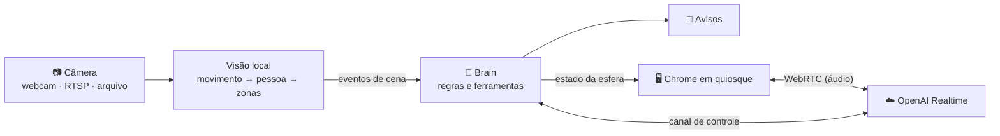

<div align="center">

# 🔵 IARA

**IA atendente para loja física: vê quem entra, cumprimenta, conversa por voz no balcão e avisa o dono.**


</div>

---

A IARA observa a loja por uma câmera, reconhece quando alguém entra, cumprimenta em português e conversa por voz com o cliente no balcão. Ela responde sobre horário, produtos, preços e pagamento, e chama uma pessoa quando não sabe a resposta. Se um cliente fica esperando sem atendimento, ela avisa o dono.

O mesmo código roda no PC de desenvolvimento (webcam) e na loja (câmera IP por RTSP). A troca é feita **só pelo `.env`**.

## ✨ Destaques

| | |
|---|---|
| 🎙️ **Conversa natural** | Voz pelo OpenAI Realtime via WebRTC, com cancelamento de eco do Chrome: dá para interromper a IA no meio da fala. |
| 👀 **Visão local e barata** | Detecção de pessoas com YOLOX-nano no ONNX Runtime, só CPU, a 2 quadros por segundo. As imagens só vão para a IA quando necessário. |
| 🗺️ **Zonas configuráveis** | Porta, balcão e área do atendente desenhadas como polígonos no `config.yaml`, com calibração visual no painel de debug. |
| 🔔 **Avisos inteligentes** | Cliente esperando sem atendimento, pessoa parada há muito tempo, pedido para falar com alguém. |
| 🔵 **Interface viva** | Esfera animada em tela cheia que reage à amplitude real do áudio: ociosa, ouvindo, pensando e falando. |
| 🔒 **Privacidade primeiro** | Nada de áudio, vídeo ou transcrição é gravado. A chave da API nunca sai do backend. |
| 💸 **Custo sob controle** | Contagem de tokens e custo do dia; a sessão de voz fecha sozinha com a loja vazia. |

## 🏗️ Arquitetura



- **Voz:** o Chrome manda a oferta WebRTC ao backend, e o backend chama a OpenAI. Assim a chave da API fica só no servidor. O áudio da IA é tocado pela própria página, então o cancelador de eco do Chrome o remove do microfone e a conversa pode ser simultânea.
- **Visão:** um filtro de movimento evita rodar o detector à toa. Um tracker associa as pessoas entre quadros, e o ponto dos pés de cada uma define em que zona ela está.
- **Brain:** transforma eventos de cena ("entrou", "no balcão", "parado") em ações: abrir a sessão de voz, cumprimentar, mandar uma imagem para a IA, disparar avisos.

## 🧠 Como a IARA decide

| Situação | Ação |
|---|---|
| Pessoa entra pela zona da porta | Abre a sessão de voz e cumprimenta (com cooldown). Quem só passa na frente da porta não é cumprimentado |
| Cliente na zona do balcão fala | Manda uma imagem da cena (só no primeiro turno) e responde |
| Alguém fala fora do balcão | Ignora (não responde a conversas paralelas) |
| A IA precisa olhar algo | Ferramenta `ver_camera`: manda uma imagem nova |
| Cliente pede uma pessoa ou a IA não sabe | Ferramenta `chamar_atendente` → aviso |
| Cliente no balcão há mais de `unattended_s` sem ninguém na zona do atendente | Aviso `cliente_esperando` |
| Pessoa parada há mais de `lingering_s` fora do balcão | Aviso `pessoa_parada` |
| Loja vazia por `session_idle_close_s` | Fecha a sessão de voz (para de gastar) |

No MVP, os avisos aparecem no console como `[AVISO ...]`.

## 🚀 Começando

### Pré-requisitos

- Windows 10/11 (ou Linux) com Python 3.11+ e [uv](https://docs.astral.sh/uv/)
- Google Chrome
- Webcam ou câmera IP com RTSP
- Chave da [OpenAI API](https://platform.openai.com/api-keys) com acesso ao Realtime e créditos

### Instalação

```powershell
# 1. uv (PowerShell)
powershell -ExecutionPolicy ByPass -c "irm https://astral.sh/uv/install.ps1 | iex"

# 2. dependências e modelo de detecção
uv sync
uv run python scripts/download_model.py

# 3. configuração local (esses arquivos não vão para o git)
copy .env.example .env                 # preencha OPENAI_API_KEY
copy config.example.yaml config.yaml   # dados da loja e zonas

# 4. backend
uv run python -m iara
```

> No Windows, prefira `uv run python -m iara` a `uv run iara`: o Controle Inteligente de Aplicativos pode bloquear o executável gerado pelo uv.

Em outro terminal, abra a página em modo quiosque:

```powershell
powershell -ExecutionPolicy Bypass -File scripts\run_kiosk.ps1
```

Na primeira vez, permita o microfone (o perfil dedicado do Chrome guarda a permissão). Para sair do quiosque: `Alt+F4`.

### Teste rápido na mesa com a webcam

1. No `.env`, coloque `CONFIG_FILE=config.webcam.yaml`. Nesse preset, ela cumprimenta quem aparecer por cerca de 1 s e conversa com quem estiver na imagem.
2. Rode `powershell -ExecutionPolicy Bypass -File scripts\dev_windows.ps1`. Ele sobe o backend e abre o Chrome com o painel de debug.

### Painel de debug

Abra `http://localhost:8000/?debug=1` no Chrome. O painel mostra:

- botões para simular os estados da esfera;
- **Conversar agora**, que abre a conversa por voz sem depender da câmera;
- a imagem da câmera com zonas e pessoas desenhadas, para calibrar o `config.yaml`;
- o `/healthz`: vídeo, página, sessão de voz, tokens e custo do dia.

> No Linux, o equivalente do quiosque é `scripts/run_kiosk.sh`. No WSL2 a webcam não aparece por padrão: use `VIDEO_SOURCE=file` ou `none`, ou rode no Windows.

## 📹 Câmera IP (RTSP)

1. No app Mercusys: **Configurações avançadas → Conta da câmera**, crie usuário e senha RTSP.
2. Descubra o IP da câmera (no app ou no roteador) e, de preferência, fixe-o com uma reserva de DHCP.
3. **Teste no VLC antes:** *Mídia → Abrir fluxo de rede* → `rtsp://usuario:senha@IP:554/stream2`. Se abrir no VLC, abre na IARA.
4. No `.env`:
   ```ini
   VIDEO_SOURCE=rtsp
   RTSP_HOST=192.168.0.50
   RTSP_USER=usuario
   RTSP_PASSWORD=senha
   RTSP_PATH=stream2        # baixa resolução, suficiente para detecção
   ```
   Ou só `RTSP_URL=rtsp://usuario:senha@IP:554/stream2`. A Tapo C500 usa o mesmo formato.
5. Recalibre as zonas no `config.yaml` com `?debug=1`: a posição da câmera muda onde a porta e o balcão aparecem na imagem.

A conexão RTSP usa TCP (mais estável em Wi-Fi), reconecta sozinha se a câmera cair e mascara a senha nos logs.

<details>
<summary><b>Simular o stream sem a câmera</b></summary>

Com `VIDEO_SOURCE=file` e `VIDEO_FILE=algum_video.mp4`, o vídeo é lido em loop pelo mesmo caminho de código do RTSP. Para um RTSP real local, use o [mediamtx](https://github.com/bluenviron/mediamtx):

```bash
./mediamtx &
ffmpeg -re -stream_loop -1 -i video.mp4 -c copy -f rtsp -rtsp_transport tcp rtsp://127.0.0.1:8554/stream2
# .env: VIDEO_SOURCE=rtsp  RTSP_URL=rtsp://127.0.0.1:8554/stream2
```
</details>

## ⚙️ Configuração

### Variáveis de ambiente (`.env`)

| Variável | Padrão | Descrição |
|---|---|---|
| `OPENAI_API_KEY` | — | Chave da OpenAI (só no backend) |
| `OPENAI_REALTIME_MODEL` | `gpt-realtime-2.1-mini` | Modelo de voz |
| `OPENAI_VOICE` | `marin` | Voz da IA |
| `OPENAI_SAFETY_ID` | `iara-loja` | Identificador da loja (não da pessoa) para a OpenAI |
| `VIDEO_SOURCE` | `webcam` | `webcam`, `rtsp`, `file` ou `none` |
| `WEBCAM_INDEX` | `0` | Índice da webcam |
| `WEBCAM_BACKEND` | `any` | `any`, `dshow`, `msmf` ou `v4l2` (no Windows, `dshow` costuma abrir mais rápido) |
| `RTSP_URL` | — | URL completa; se preenchida, ignora os campos abaixo |
| `RTSP_HOST` / `RTSP_PORT` / `RTSP_USER` / `RTSP_PASSWORD` / `RTSP_PATH` | — / `554` / — / — / `stream2` | Partes da URL RTSP |
| `VIDEO_FILE` | — | Arquivo de vídeo para `VIDEO_SOURCE=file` |
| `DETECTION_FPS` | `2` | Quadros por segundo analisados |
| `DETECTOR_MODEL` | `models/yolox_nano.onnx` | Modelo de detecção |
| `AUDIO_DUPLEX` | `full` | `full` (simultâneo) ou `half` (walkie-talkie: muta o microfone enquanto a IA fala) |
| `HOST` / `PORT` | `127.0.0.1` / `8000` | Servidor local |
| `CONFIG_FILE` | `config.yaml` | Dados da loja, zonas, tempos e textos |
| `LOG_LEVEL` | `INFO` | Nível de log |

O valor do `.env` só substitui o padrão quando a variável está definida. Uma variável de ambiente do sistema tem prioridade sobre o `.env`. O `.env` é lido a partir da pasta onde o comando é executado.

### `config.yaml`

- **`store`:** nome, horário, endereço, produtos e preços, outras informações. É tudo o que a IA sabe responder; ela não inventa o que não está aqui.
- **`zones`:** polígonos `door`, `counter` e `staff` em coordenadas de 0 a 1 (x da esquerda para a direita, y de cima para baixo). Vale o ponto dos pés de cada pessoa.
- **`detection`:** limiares, tempo para "pessoa parada" (`lingering_s`) e para "cliente sem atendimento" (`unattended_s`).
- **`brain`:**
  - `greet_cooldown_s`: intervalo mínimo entre saudações;
  - `alert_cooldown_s`: intervalo mínimo entre avisos do mesmo tipo;
  - `session_idle_close_s`: fecha a sessão de voz com a loja vazia.
- **`texts.greeting`:** `{periodo}` vira "Bom dia", "Boa tarde" ou "Boa noite"; `{loja}` vira o nome da loja.
- **`prices`:** preços por token usados na estimativa de custo.

## 🔒 Privacidade (LGPD)

- Nada é gravado: nem áudio, nem vídeo, nem as imagens enviadas à IA (ficam só em memória).
- Transcrições não são pedidas nem registradas. Os logs têm só tipos de evento e contagens de tokens.
- A imagem de calibração (`/api/debug/frame.jpg`) é gerada na hora, e o servidor escuta só em `127.0.0.1`.
- A IA é instruída a não descrever nem tentar identificar pessoas.
- A chave da OpenAI e as credenciais da câmera ficam só no `.env`, que não vai para o git.
- Lembre-se de colocar o aviso de monitoramento na loja.

## 💸 Custos

Cada resposta registra no log os tokens (texto, áudio, imagem, cache) e o custo estimado do dia, com preços configuráveis em `prices` no `config.yaml`. Os valores vêm da tabela da OpenAI de outubro de 2026; confira se mudaram. A sessão de voz só fica aberta com gente na loja.

## 🧪 Testes

```bash
uv run pytest                 # sem hardware: Brain, eventos, tracker, zonas, mapeamento Realtime, vídeo de arquivo, servidor
uv run pytest -m integration  # RTSP real: precisa do mediamtx em localhost:8554 e ffmpeg
uv run ruff check
```

## 📁 Estrutura

```
src/iara/
  app.py              composição: único lugar que escolhe implementações pela configuração
  config.py           .env + config.yaml
  domain.py           Frame, BBox, Track, eventos de cena
  usage.py            contagem de tokens e custo do dia
  video/              VideoSource + OpenCvSource (webcam/RTSP/arquivo, reconexão)
  vision/             movimento, detector YOLOX, tracker, zonas, EventDetector, pipeline
  voice/              VoiceSession (interface neutra) + OpenAI Realtime + fake para testes
  brain/              regras, prompts em pt-BR, ferramentas
  notify/             Notifier (console; depois WhatsApp/Telegram)
  web/                FastAPI (página, WebSocket, oferta WebRTC, debug) + página estática
    static/orb.js     a esfera: componente isolado (setState/setLevel), troque o visual aqui
scripts/              download do modelo, quiosque (Windows/Linux), ambiente de dev no Windows
tests/                testes sem hardware + integração RTSP opcional
```

## 🛠️ Problemas comuns

- **A IA se ouve (eco):** confirme que o som sai pelo Chrome da página da IARA. Se o eco persistir com caixas de som altas, use `AUDIO_DUPLEX=half`.
- **"Toque para ativar o som":** o Chrome bloqueou o áudio automático. O `run_kiosk` usa `--autoplay-policy=no-user-gesture-required`.
- **"Microfone indisponível":** permita o microfone para `localhost` nas configurações do Chrome (perfil do quiosque).
- **Webcam não abre no Windows:** teste `WEBCAM_BACKEND=dshow` ou outro `WEBCAM_INDEX`.

<details>
<summary><b>Desenvolvendo no WSL e no Windows ao mesmo tempo</b></summary>

O código fica numa pasta só, no disco do Windows, e o WSL acessa a mesma pasta por `/mnt/c/...` (ou por um link simbólico). Cada sistema precisa do próprio ambiente Python, porque os dois não podem dividir o mesmo `.venv`:

- **Windows:** usa o `.venv` padrão. Rode com `scripts\dev_windows.ps1` ou `uv run python -m iara`, sem `UV_PROJECT_ENVIRONMENT` definido.
- **WSL** (testes, edição, git): use um ambiente fora da pasta do projeto:
  ```bash
  export UV_PROJECT_ENVIRONMENT=~/.venvs/iara UV_LINK_MODE=copy
  ```

O `.gitattributes` fixa o fim de linha em LF, e `git config core.fileMode false` evita que o `/mnt/c` marque arquivos como modificados por causa de permissões.
</details>

## 🗺️ Próximos passos

- [ ] Avisos pelo WhatsApp ou Telegram (hoje só no console)
- [ ] Consulta de produtos e preços por ferramenta, para catálogos maiores
- [ ] Integração com o PDV para montar a pré-venda por voz
